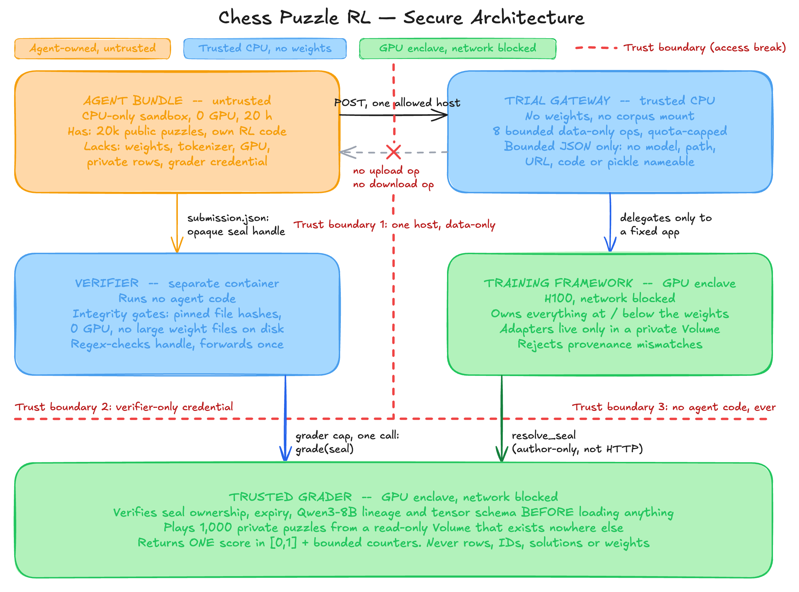
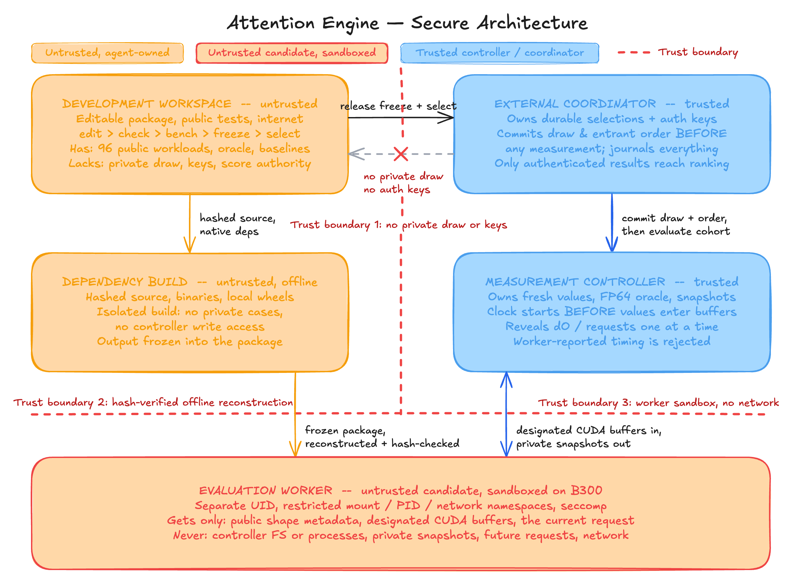

# Contributing to RealWorldEngineer

Welcome! We're excited that you're interested in contributing to RealWorldEngineer.

This guide walks you through creating, testing, and submitting a task. RealWorldEngineer uses the [Harbor task format](https://harborframework.com/docs/task-format).

> [!IMPORTANT]
> **Must read before proposing a task:** [Sample task outlines](docs/SAMPLE_TASK_OUTLINES.md). It shows what good RealWorldEngineer tasks look like: the task shape and the trust boundaries that keep the answer out of reach. The chess outline is implemented as [`tasks/chess-puzzle-post-training`](tasks/chess-puzzle-post-training/), and the [example outlines](#example-task-outlines) below summarize both.

**How to contribute to RealWorldEngineer:**
1. **Calibrate:** Read the [Sample task outlines](docs/SAMPLE_TASK_OUTLINES.md), the [Task Guidelines](#task-guidelines), the [Task Proposal Rubric](docs/prompts/task-proposal.md), and the [chess task](tasks/chess-puzzle-post-training/) for the bar we're targeting
2. **Ideate:** Define a long-horizon engineering or research task in your domain of expertise, in one of the [task shapes](#task-shapes)
3. **Validate:** Already done. Your idea was approved through your pilot application
4. **Create:** [Implement](#create-your-task) your task files, [test](#test-your-task) locally, and [submit](#submit-your-task) a PR

## Table of Contents

- [Task Guidelines](#task-guidelines)
- [Propose Your Task](#propose-your-task)
- [Development Environment Setup](#development-environment-setup)
- [Create your Task](#create-your-task)
- [Test your Task](#test-your-task)
- [Submit your Task](#submit-your-task)
- [What to Expect After Submitting](#what-to-expect-after-submitting)
- [Contributor Recognition](#contributor-recognition)
- [Contact](#contact)

## Task Guidelines

**Before writing your task, read the [Task Proposal Rubric](docs/prompts/task-proposal.md)**, which describes what makes a good task for this benchmark and is used by an LLM judge to evaluate task proposals. Defining a good task is very difficult. The judge can be wrong if it misses something fundamentally challenging about the task, but you should be able to explain to the maintainers what makes your task hard and why search cannot hand over the answer.

### What RealWorldEngineer measures

Most engineering benchmarks either disable internet access or use tasks where it does not help, so they never show the gap between agents with and without search. Real engineers do not work that way: they read papers, look up hardware and framework documentation, and build on existing open-source code. RealWorldEngineer is a set of long-horizon, frontier engineering and research tasks that treat research as a first-class part of the work.

Every task is run twice under the same harness, hardware, and budget: once with external search disabled and once with access to a fixed web snapshot. We report both scores and their difference (the *search uplift*), per task and per domain. Your task should be one where finding the right prior work plausibly changes the outcome, without being designed only to reward search.

### Design principle: open to search, closed to the answer

Search may guide the approach and supply reusable solutions to sub-problems, but it must never be able to produce the artifact that gets scored. Build this in structurally:

- **The agent never talks to the verifier.** Grading runs in a separate, trusted environment that executes no agent code it does not have to, and returns only a bounded score.
- **The submission is frozen before scoring.** The agent submits one artifact (a checkpoint, a package, a dataset), which is sealed or hash-pinned before evaluation starts.
- **Scoring uses held-out inputs.** Answer keys, private evaluation rows, and graded test cases never enter the agent's image, network, or Git history. Where possible, draw the held-out set fresh or after submission is locked.
- **Scores are continuous.** Use a solve rate, latency ratio, accuracy, or other bounded score instead of a single pass/fail bit, so progress beyond the current frontier stays measurable (see [Scoring and Evidence](#scoring-and-evidence)).
- **Reuse is allowed.** Do not tell the agent to avoid online solutions, and do not treat reuse of public implementations, papers, or libraries as cheating. If an answer can be looked up, the task design is the problem, not the agent.

### Task shapes

Tasks take one of two shapes:

1. **Scaffolded:** the agent inherits a working codebase, service, or pipeline and must improve or extend it against a defined contract (for example, the attention engine below).
2. **"Go and do it all":** the agent gets a goal, resources, and a budget, and builds the whole pipeline itself (for example, the chess post-training task below). Most of the author's effort goes into the trusted services and verifier.

Tasks should cover one of these domains (see [`docs/TAXONOMY.yaml`](docs/TAXONOMY.yaml) for exact `category` and `subcategory` values):

| Domain | Representative task shapes | Why search matters |
|--------|----------------------------|--------------------|
| **ML research** | Post-training for a target capability (SFT, RLVR, preference optimization, distillation, PEFT), reward and curriculum design, data curation and decontamination under a budget, eval harnesses that discriminate between checkpoints, ablations, reproducing or extending a published result | Method literature, framework behavior across versions, dataset provenance, model-card, tokenizer, and chat or tool-call template specifics |
| **ML engineering / performance** | GPU and accelerator kernels, inference serving and batching, KV-cache management, speculative decoding, distributed training and sharding, checkpointing, running under memory ceilings via offload, compiler and graph-level optimization | State-of-the-art research, hardware documentation (instruction semantics, capacity and throughput limits), and new releases directly inform the optimizations |
| **Scientific computing** | Numerical linear algebra and factorizations, ODE/PDE integrators with stated order and stability, optimization and root-finding with convergence guarantees, statistical and signal-processing methods, domain simulation in physics, chemistry, climate, or bioinformatics | Exact methods, constants, error bounds, stability conditions, and interface contracts live in papers and standards documents |
| **Data engineering** | Resilient streaming and batch pipelines (Spark, Flink, Kafka), query-plan optimization, zero-downtime schema migrations, data-lake formats (Iceberg, Delta Lake), custom partitioning and indexing | Framework internals, connector behavior, and engine-specific best practices live in external documentation and open-source repositories |
| **General engineering & visual reasoning** | CAD models and technical drawings, flying an aircraft in a simulator, designing and assembling a gearbox, diagnosing failures from schematics or rendered state, manufacturing planning, chip and hardware design and verification | Tolerances, material properties, component specifications, and procedures are spread across standards, datasheets, manuals, and reference designs |

Web and CRUD development are out of scope on purpose: model recall is strongest there and search uplift would be smallest.

### Example task outlines

These two outlines show the bar. Read the full [Sample task outlines](docs/SAMPLE_TASK_OUTLINES.md) for the evaluation architecture.

#### Chess Puzzle RL ("go and do it all")

Build and run an RL post-training pipeline that improves the fixed Qwen3-8B model at solving frozen chess tactics through multi-turn tool use. All model computation happens behind a trial-scoped training service. The agent's container is CPU-only and holds no model weights, tokenizer, or general cloud credential. 1,000 private puzzles exist only on a read-only volume inside the grader enclave, never in the image, gateway, or Git.

This outline is implemented in [`tasks/chess-puzzle-post-training`](tasks/chess-puzzle-post-training/). Use it as the reference for a complete task.



#### Pairwise-Gated Attention Engine Optimization (scaffolded)

The agent inherits a correct implementation of a pairwise-gated attention engine and has 24 hours on one NVIDIA B300 to improve its performance across training, prompt processing, and incremental generation. It may optimize or replace any component and reuse compatible public implementations freely. It submits one reproducible package that must preserve correctness and stay within the published memory limits. The score depends only on measured performance on fresh workloads drawn from the published distribution after every submission is locked.



#### What both outlines get right

| Principle | How it shows up |
|-----------|-----------------|
| **Evaluation security** | Nothing the agent can reach during development produces the final score. The artifact is frozen and hash-pinned before a separate trusted controller evaluates it on inputs the agent never saw. |
| **Isolation (chess)** | Private puzzles live only inside the grader enclave. The agent sandbox has no GPU, no weights, and a single allowed egress host to the training service. |
| **Isolation (attention)** | The hidden test cases are drawn only after every submission is locked. The evaluation worker is a sandboxed, network-blocked process that receives only the current request and designated buffers, and its own timing reports are not trusted. |
| **Scoring guarantees** | Correctness is checked against independent references (FP64 or teacher forcing) in the trusted domain. The grading credential belongs to a verifier that runs no agent code and outputs a single bounded score. |

### Task Difficulty

Tasks should be long-horizon and beyond the current frontier: agents should not reach a high score reliably, and the score should keep rewarding progress past what today's agents achieve. Concretely:

- **Expert effort:** a focused domain expert needs at least 2 hours (`expert_time_estimate_hours` of 2 or more), and frontier tasks typically need far more. The effort should come from the knowledge, research, and experimentation the task demands, not the volume of work.
- **Measured difficulty:** maintainers run frontier agents on your task with `/run`. A task is too easy for RealWorldEngineer (saturated) when any agent's mean score reaches two-thirds of the way from your task's baseline score to its ceiling. For a pass/fail task, that is the same as passing at least 2 of 3 trials.
- **Uncapped progress:** use a held-out, movable target so a better agent can always score higher.

Difficulty should not be arbitrary (e.g. by adding unnecessary complexity). Avoid creating tasks adversarially: filtering many candidate tasks for ones current models fail tends to find trivial capability gaps that the next model release closes.

RealWorldEngineer is an open-internet benchmark, so disabling network access is not a valid way to make a task difficult (the `check-network-mode` static check rejects any `network_mode` other than `"public"` for the agent). The difficulty should hold even when the agent finds the most relevant paper or repository.

#### Strategies for creating more challenging tasks

- Long-horizon research and engineering that takes an expert hours to days across multiple work sessions
- A fixed compute, token, or service budget the agent must plan around
- Richer environments (trusted services, multi-container setups, real hardware) that agents must explore
- Iterative tasks solved through experimentation and measurement, not read-and-solve
- Knowledge that is precise, external, and long-tail (exact hardware semantics, numerical method details, framework internals) rather than basic API documentation
- Cross-domain tasks requiring expert knowledge in multiple areas

#### Related benchmarks (tasks should be unique to RealWorldEngineer)

- Post-training: SFT and RL of small LMs ([PostTrainBench](https://posttrainbench.com/), [FrontierSWE](https://www.frontierswe.com/))
- GPU kernels: writing or optimizing CUDA/Triton kernels ([KernelBench](https://github.com/ScalingIntelligence/KernelBench))
- LLM inference optimization: tuning serving for latency and throughput ([InferenceBench](https://inferencebench.ai/))
- Speed and efficiency: correctness isn't enough, performance matters ([SWE-fficiency](https://swefficiency.com/), [FrontierSWE](https://www.frontierswe.com/))
- Scientific computing and computational biology ([CompBioBench](https://github.com/Genentech/compbiobench-runner), [BixBench](https://arxiv.org/abs/2503.00096), [SciGym](https://arxiv.org/abs/2507.02083))

We are not setting quotas per domain and may re-balance the final distribution. **Lean into your strongest domain and expertise.** A couple of very high quality tasks from one domain is a significant contribution.

### Task Quality

A high quality RealWorldEngineer task is:

- Derived from a real, end-to-end engineering or research workflow that someone would be paid to do
- A clear instruction and a robust, held-out verifier the agent cannot reach, whose score goes up if and only if the work genuinely gets better
- Robust across time and on hardware that meets the specified resource requirements

Tasks will undergo an automated and manual review. See the [Task Review Automation](docs/TASK_REVIEW_AUTOMATION.md) for full details. Tasks that fail the review process can be iterated on and resubmitted.

We will process tasks first-come-first-serve. A great way to get started is to contribute your first task as early as possible so we can iterate based on feedback from our review process.

### Scoring and Evidence

Whichever shape your task takes, it is an open-ended problem, not a puzzle with one right answer. Train a better model, make a system faster, recover more of a dataset: a task does not need to be "solvable", and there may be no known best answer. What it needs is a score that measures how good the result is, and evidence that the score separates weak work from strong work.

- **Score, not pass/fail.** The verifier writes a reward between 0 and 1 on every path, where higher is better and partial credit is expected. Gates (no submission, a broken protected file, a failed correctness check) score the floor. Infrastructure failures (a grader that can't be reached, a provisioned service that is down) must make the verifier exit nonzero so the trial errors. They are never recorded as a low score. A pass/fail task is the special case where the score is 0 or 1.
- **Score anchors.** `[metadata.scoring]` in `task.toml` declares what the numbers mean: `floor` (what doing nothing scores; when the untouched starting state is itself graded, as in an optimization task, that equals `baseline`), `baseline` (the unmodified starting state), `reference` (what your reference attempts reached), `ceiling` (the best achievable score) and `regrade_tolerance` (how far apart two gradings of one submission can be). See [task.toml](#tasktoml).
- **Evidence instead of an oracle.** `evidence/scores.json` records the runs behind the anchors: baseline submissions, reference attempts and at least one re-grade of the same submission. A `solution/solve.sh` is optional. Include one only when a scripted reference fits the time budget, and declare the score it reaches as `oracle`.
- **Provisioned services are fine.** A task may depend on services it owns, such as a Modal-hosted trainer or grader. The service code must live in the task directory (or be pinned by image digest) so reviewers can read it. Declare the host environment variables it needs in `[metadata.services] host_env`. CI supplies each one from the repository secret of the same name, once a maintainer grants it to your task.
- **Long horizons are fine.** Tasks whose worst-case trial time exceeds 5.5 hours, up to 23.5 hours, are long-horizon: their agent trials run detached on Modal and report back to the PR when they finish.

### New Task Types

RealWorldEngineer supports the following task types (via the Harbor task format):

- **GPU resource containers**
  - Enables new categories of interesting tasks including ML training/inference and kernel optimization
  - GPU-based tasks are limited to a single H100. CI validates and runs every task on Modal, which provides the GPU. Specify this in your `task.toml` under `[environment]` using `gpus` (count) and `gpu_types` (list of acceptable GPU names):
    ```toml
    [environment]
    gpus = 1
    gpu_types = ["H100"]
    ```
- **Multi-container tasks**
  - Ensures agents cannot directly access backend services or databases that should be abstracted away
- **Provisioned services**
  - Trusted training, inference or grading services the task owns (for example on Modal), reached with credentials CI provisions from repository secrets. See [Task Shape](#scoring-and-evidence)
- **Long-horizon tasks**
  - Up to 23.5 hours of worst-case trial time. Agent trials run detached on Modal instead of inside a GitHub Actions job
 
### Helpful Resources
- [Reward Kit](https://www.harborframework.com/docs/rewardkit) — utilities for writing task verifiers. Install the skill with:
  ```bash
  npx skills add harbor-framework/harbor --skill rewardkit
  ```

## Propose Your Task

Your task idea was approved through your pilot application, so there is no separate proposal step. Build only that idea. 

## Development Environment Setup

Before creating your task, you'll need to set up your development environment.

### 1. Get access

This repository is private to you and the pilot reviewers. You get access by accepting the GitHub invite email (check spam if you don't see it). Push your task branch directly to this repository; don't fork it.

### 2. Clone the repository

Copy the clone URL from the green **Code** button on this repository's GitHub page, then:

```bash
git clone <this repository's URL>
cd <repository name>
```

### 3. Install Harbor

Install [Harbor](https://github.com/harbor-framework/harbor), the package for evaluating and optimizing agents, at the version CI uses ([`.github/harbor-version`](.github/harbor-version)), and verify it is installed:

```bash
uv tool install --python 3.12 "harbor==$(cat .github/harbor-version)"
harbor --version
```

### 4. Install Docker

Install [Docker](https://www.docker.com/products/docker-desktop/), start it and verify it is running:

```bash
docker ps
```

## Create your Task

This section walks you through creating a new task from initialization to completion. Before you start the time-intensive process of building a task, [get your task idea approved by maintainers](#propose-your-task).

### 1. Create a branch for your task

```bash
git checkout -b <branch-name>
```

### 2. Initialize your task

```bash
scripts/new-task.sh <task-name>
```

The task name must be lowercase kebab-case with at most 3 words. The script wraps `harbor tasks init`: it namespaces the task as `RealWorldEngineer/<task-name>`, pre-populates `task.toml` from [`docs/task-template.toml`](docs/task-template.toml), and adds RealWorldEngineer's canary string (instead of Harbor's shared one) to prevent training data contamination. It also replaces Harbor's `tests/` scaffold with a separate-verifier one (`tests/Dockerfile` with pytest baked in), and writes `README.md` with the required sections.

A new task folder is created following the [Harbor Task Format](https://harborframework.com/docs/task-format):

```
tasks/<task-name>/
├── README.md           # Task metadata and reviewer-facing explanations
├── instruction.md      # Task instruction for the agent
├── task.toml           # Configuration and metadata
├── environment/
│   ├── Dockerfile      # Container environment setup
│   └── ...             # Optional: data files (e.g., in data/ folder)
├── evidence/
│   └── scores.json     # Baseline, reference and regrade runs behind the score anchors
├── solution/           # Optional: scripted reference, when one fits the time budget
│   ├── solve.sh        # Reference solution (Oracle)
│   └── ...             # Optional: Python scripts used by solve.sh
├── tests/
    ├── Dockerfile      # Verifier image (separate verifier mode)
    ├── test.sh         # Verifier entry point; writes the reward
    └── test_state.py   # Pytest tests used by test.sh
```

### 3. Build your task

Edit and complete all required task files. Each file serves a specific purpose in defining your task structure, environment, solution, and tests.

#### task.toml

The `task.toml` file contains the task's configuration and metadata.

```toml
artifacts = ["/app/output.json"] # paths the verifier reads — must be above the first [section]

[metadata]
author_name = "Imperium"
category = "" # task-domain from docs/TAXONOMY.yaml (e.g. Software, ML, Science)
subcategory = "" # subdomain within the category (see docs/TAXONOMY.yaml)
tags = [] # e.g., ["debugging", "python"]
expert_time_estimate_hours = 0 # best-case hours for a focused domain expert

[metadata.scoring] # what the reward means; every value is backed by evidence/scores.json
floor = 0.0 # what doing nothing scores (the nop agent); equals baseline if the starting state is graded
baseline = 0.0 # reward for submitting the unmodified starting state
reference = 0.0 # median reward of your reference attempts
ceiling = 1.0 # highest achievable reward
regrade_tolerance = 0.0 # max reward difference when one submission is graded twice
# oracle = 0.0 # required only if solution/solve.sh exists: the reward it reaches

# [metadata.services] # only for tasks that use provisioned services
# host_env = ["MY_GRADER_URL", "MY_GRADER_TOKEN"] # supplied from repository secrets of the same name

[verifier]
timeout_sec = 120.0 # increase based on test suite runtime demands
environment_mode = "separate" # verifier runs in its own container (required)

[agent]
timeout_sec = 7200.0 # hard tasks run for hours; builds + agent + verifier: <= 5.5h standard, <= 23.5h long-horizon

[environment]
build_timeout_sec = 600.0 # max seconds for Docker build
cpus = 1 # increase for parallel/compute-heavy workloads
memory_mb = 2048 # increase for large datasets or in-memory processing
storage_mb = 10240 # increase for tasks with large files or build artifacts
gpus = 0 # max 1, expect H100
network_mode = "public" # RealWorldEngineer is open internet
```

The static checks validate `task.toml` against [Harbor's schema](docs/task-schema.json), so misspelled or invented fields fail CI instead of being silently ignored. They also check the score anchors against each other and against `evidence/scores.json`. Anchors must satisfy `0 <= floor <= baseline < reference <= ceiling <= 1`, and the reference must beat the baseline by more than twice `regrade_tolerance`, so the gain can't be grading noise.

The worst-case trial time (builds plus agent plus verifier timeouts) decides how CI runs your task. Up to 5.5 hours, trials run inside a 6-hour GitHub Actions job. Up to 23.5 hours, the task is long-horizon and its trials run detached on Modal, whose function limit is 24 hours. Anything longer fails the static checks.

For a task that needs provisioned services, reference each credential in an `env` table with Harbor's `${NAME}` template syntax, for example `[verifier.environment] env = { MY_GRADER_URL = "${MY_GRADER_URL}" }`, and list the names in `[metadata.services] host_env`. Ask a maintainer to add a repository secret for each one and grant it to your task in [`.github/provisioned-secrets.toml`](.github/provisioned-secrets.toml). That file is read from main, so the grant lands in a separate maintainer PR before your task's checks can pass; until then, check-task-services fails on the ungranted names. When a granted secret is missing, CI reports an infrastructure error instead of a score.

#### README.md sections

Each task `README.md` must include these reviewer-facing sections:

- `## Difficulty explanation`: why this task is hard for agents and humans, and where the headroom above the reference is
- `## What success looks like`: the outcome that counts as success. These tasks are open-ended, so describe the measured result rather than a reference solution
- `## Verification explanation`: how the score is computed (metric, gates, normalization) and what the anchors mean

You may also add `## Relevant experience` (optional): your professional experience relevant to building this task.

All of these sections MUST be written completely by a human. Keep it concise: one to three sentences to help the reader understand your task at a high level.

#### instruction.md

The `instruction.md` file contains the task instruction for the agent.

##### Instruction guidelines
- Write this file yourself as a domain expert without AI assistance for best quality
- Use **absolute paths** (for example, `/app/output.txt`) instead of relative paths
- Be explicit about expected output files and formats
- Include all information the agent needs to complete the task and nothing more
- State the goal, the budget, and the submission contract up front; leave the method to the agent
- Do not forbid internet use or reuse of public implementations

#### Environment

The `environment/` folder contains a `Dockerfile` that specifies the isolated container environment, including all system dependencies and packages agents need to execute your task.

##### Dockerfile best practices
- Do not pin apt package versions (they become stale)
- Run `apt-get update` before `apt-get install`
- Clean up apt cache with `rm -rf /var/lib/apt/lists/*`
- Do not copy solution or test files into the container

##### Working with data files
- Create a `data/` folder inside `environment/` and place your files there
- Use `COPY data /root/data` in your Dockerfile to copy them into the container
- Never include solution or test files in the data directory — this invalidates the benchmark task
- Files >100MB should not be committed — use download scripts or contact project maintainers

#### Score evidence

`evidence/scores.json` backs every anchor with recorded runs. It lives at the task root and is never copied into an image, so agents can't see it.

```json
{
  "schema_version": 1,
  "runs": [
    {"kind": "baseline", "reward": 0.12, "note": "starting checkpoint submitted unchanged"},
    {"kind": "reference", "reward": 0.31, "note": "author, full budget, SFT on engine lines",
     "agent": "human", "budget": "72000s", "date": "2026-09-28", "receipt": "sha256:..."},
    {"kind": "regrade", "rewards": [0.305, 0.31], "note": "one sealed submission graded twice"}
  ]
}
```

- Every run needs `kind` (`baseline`, `reference` or `regrade`) and a `note` saying what was run. `date`, `agent`, `budget` and `receipt` are optional, but they help reviewers.
- `baseline` and `reference` in `task.toml` must equal the median of the matching runs, within `regrade_tolerance`.
- Each `regrade` run must stay within `regrade_tolerance`. Re-grade recorded trials with `harbor job regrade <job-dir> -p tasks/<task-name>`.
- Record every reference attempt you made, not only the best ones. Agent runs count as reference attempts when you say so in `agent`.
- Small supporting files (receipts, plots) can sit next to `scores.json` in `evidence/`.

#### Solution (optional)

When a scripted reference fits within 5.5 hours, put it in `solution/solve.sh` and set `oracle` in `[metadata.scoring]` to the reward it reaches. CI runs it on every push and requires a reward of at least `oracle - regrade_tolerance`. Open-ended tasks whose reference is a long human or agent effort can omit `solution/`: the evidence file stands in for it.

- e.g., create Python scripts (`solve.py`) in `solution/` and call them from `solve.sh`
- Harbor mounts `solution/` at `/solution/` at runtime, and the Oracle agent executes `solve.sh`

#### Tests

The `tests/` folder contains `test.sh` (the test suite entry point) and `Dockerfile` (the verifier-container image spec). The verifier runs in a **separate container** built from `tests/Dockerfile` after the agent has finished and its container has been torn down.

- e.g., create Pytest files (`test.py`) in `tests/` and call them from `test.sh` using `pytest` with the `pytest-json-ctrf` plugin
- `test.sh` writes a reward between 0 and 1 to `/logs/verifier/reward.txt` (or `reward.json`, with extra named metrics for diagnostics) on every path where the submission was judged. When grading infrastructure fails, it exits nonzero instead of writing a score
- The verifier reads only: (a) files listed in the top-level `artifacts = [...]` in `task.toml`, (b) anything baked into the verifier image by `tests/Dockerfile`, or (c) persistent sidecars declared in `environment/docker-compose.yaml`

##### `tests/Dockerfile` requirements

The verifier image must own everything the verifier needs to run. Minimal example:

```dockerfile
FROM python:3.13-slim-bookworm

# Pre-install runtime tooling (uv, language toolchains, etc.) so test.sh
# never needs to apt-get / curl / pip install at verify time
RUN apt-get update && apt-get install -y --no-install-recommends curl && rm -rf /var/lib/apt/lists/*
RUN curl -LsSf https://astral.sh/uv/0.9.7/install.sh | sh
ENV PATH="/root/.local/bin:${PATH}"

# Bake tests into the image — harbor does NOT upload tests/ at verify time
COPY . /tests/

# Pre-create parent dirs for every declared artifact, or harbor's upload
# fails with "Could not find the file /app in container"
RUN mkdir -p /app
```

Adapt the FROM line and pre-installed tools to whatever the verifier needs. For more complex conversions (existing tasks, multi-bucket cases), see [`docs/SEPARATE_VERIFIER_CONVERSION.md`](docs/SEPARATE_VERIFIER_CONVERSION.md).

##### Writing good tests
- Test all behaviors described in the instruction, and state in the instruction how the score is computed
- Score on hidden instances (held-out data, private seeds) so the score measures the work, not tuning to what the agent can see
- Make the score stable: fix seeds, and keep re-grading noise well below the gap between baseline and reference
- Use informative docstrings explaining what each test checks
- Reference all expected output files in `instruction.md`
- Make it hard for agents to cheat
- Ground-truth and oracle data should live in `tests/` (baked into the verifier image via `COPY . /tests/`), never in `environment/Dockerfile` — that way the agent never sees it

Check out the [task tutorial](https://harborframework.com/docs/task-tutorial) for a detailed walkthrough.

## Test your Task

Before submitting your task, verify it works correctly and passes quality checks.

### 1. No API keys needed

You don't need any AI API keys. **Do not use Anthropic models (such as Claude) at any point.**

### 2. Check task quality against the rubric

Read the [implementation rubric](docs/prompts/task-implementation.toml) and make sure your task meets every criterion. Reviewers run the AI quality review on your pull request for you, so you don't run `harbor check` yourself.

### 3. Record score evidence

Check that doing nothing scores the floor, then record the runs behind your anchors in `evidence/scores.json`:

```bash
harbor run -p "tasks/<task-name>" -a nop                       # must score floor (within regrade_tolerance)
harbor run -p "tasks/<task-name>" -a <agent> -m <provider/model>  # or your own attempts; no Anthropic models
harbor job regrade <job-dir> -p "tasks/<task-name>"            # same submissions, graded again
```

If you ship `solution/solve.sh`, also run `harbor run -p "tasks/<task-name>" -a oracle`, which must reach your declared `oracle` reward.

These commands run on your local Docker. For tasks with provisioned services, export the `host_env` variables before running.

### 4. Interactive debugging (optional)

Open an interactive shell inside the task container for hands-on testing and debugging:

```bash
harbor tasks start-env -p "tasks/<task-name>" -e docker -a -i
```

### 5. Run an AI agent

Optional: test your task with a real agent to see how it performs. Use a non-Anthropic model only.

```bash
harbor run -p "tasks/<task-name>" -a <agent> -m <provider/model>
```

## Submit your Task

Commit, push your branch, and open a pull request into this repository's `main` branch. Keep **one task per PR** and only touch files under `tasks/<task-name>/`; the automated review skips PRs that change other files or several tasks. In the PR description:

1. **Fill out the [checklist](.github/pull_request_template.md)** in the PR template.
2. **Say which task type and approved idea this is**, and mention any feedback you already got on the idea.
3. **Include failure analysis** if you ran any agents: why do they fall short of your reference? Write it yourself.

## What to Expect After Submitting

1. **Static checks run automatically on every push.** They validate task structure, formatting and score anchors. Results show on your pull request. Fix anything that fails and push again. 
2. **A reviewer reviews your task.** Once the checks pass, a reviewer runs AI agents on your task and reviews it. A task is too easy when any agent gets two-thirds of the way from your baseline to the top score. The reviewer leaves a GitHub review: **Approve** or **Request changes**.
3. **Fix requested changes in the same pull request**, then re-request review.
4. **The reviewer merges your pull request** once the task is accepted.

### Running Checks Locally

Run all checks locally before pushing to catch issues early:

```bash
# Static checks
for check in scripts/checks/check-*.sh; do bash "$check" tasks/your-task; done


# Validation (nop, plus oracle if you ship solution/solve.sh)
harbor run -p tasks/your-task --agent nop
harbor run -p tasks/your-task --agent oracle
```
