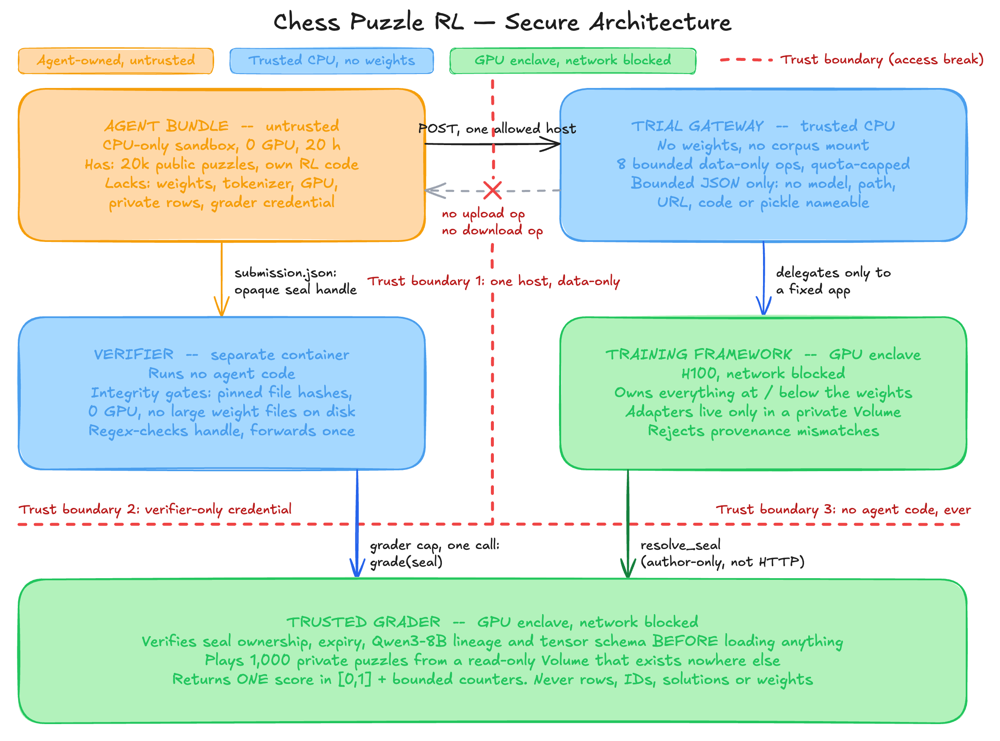
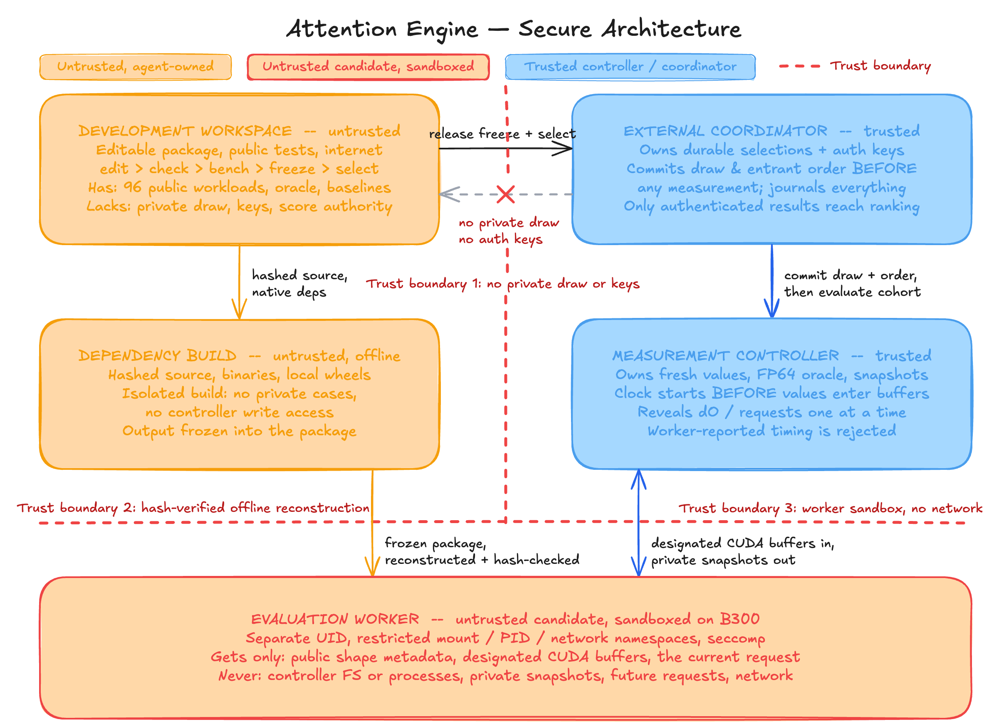

# Sample task outlines

Task 1: **Chess Puzzle RL**

Build and execute an RL post-training pipeline that improves the fixed **Qwen3-8B** model at solving frozen chess tactics through multi-turn tool use. All model computation happens behind the trial-scoped Chess-Gym training service. The container is CPU-only and contains no model weights, tokenizer, Modal SDK, or general cloud credential.

Implemented as [`tasks/chess-puzzle-post-training`](../tasks/chess-puzzle-post-training/).

Task 2: **Pairwise-Gated Attention Engine Optimization**

You inherit a correct implementation of a pairwise-gated attention engine. You have 24 hours on one NVIDIA B300 to improve its performance across training, prompt processing and incremental generation. Optimize or replace any component, and reuse compatible public implementations freely. Submit one reproducible package that preserves correctness and stays within the published memory limits. Your score depends exclusively on its measured performance on fresh workloads from the published distribution.

**Security & Evaluation Architecture**

| Architectural Principle | Implementation Details |
| --- | --- |
| **Evaluation Security & Anti-Cheating** | Both designs are secure with search usage enabled because nothing the agent reaches during development produces the final score. The artifact produced is frozen and hash-pinned before evaluation runs on a separate trusted controller using inputs the agent never saw. |
| **Task 1: Isolation Mechanics** | 1,000 private puzzles exist exclusively on a read-only volume inside the grader enclave (never in the image, gateway, or Git). The chess sandbox has no GPU, no weights, and a single allowed egress host. |
| **Task 2: Isolation Mechanics** | Each participant must lock in one final version of their engine before the deadline. Only after every participant’s final version is locked and can no longer be changed does the organizer randomly select the 96 hidden test cases. The attention worker is a sandboxed, network-blocked process receiving only the current request and designated buffers; its timing and completion messages are not trusted. |
| **Verification & Scoring Guarantees** | Correctness is checked against independent FP64 or teacher-forcing references in the trusted domain. The grading credential is held by an independent verifier running no agent code, and outputs only a single bounded score value. |
